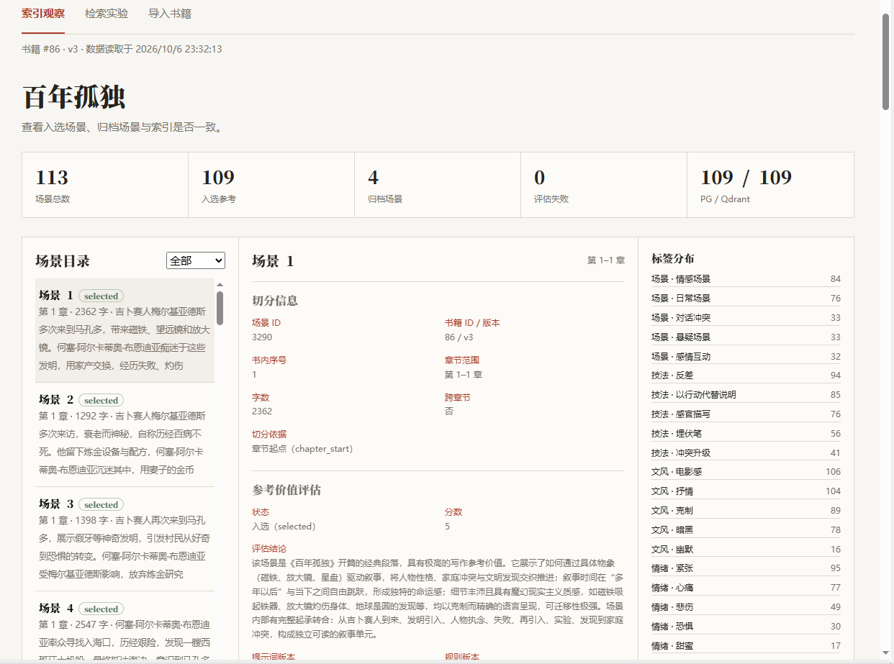
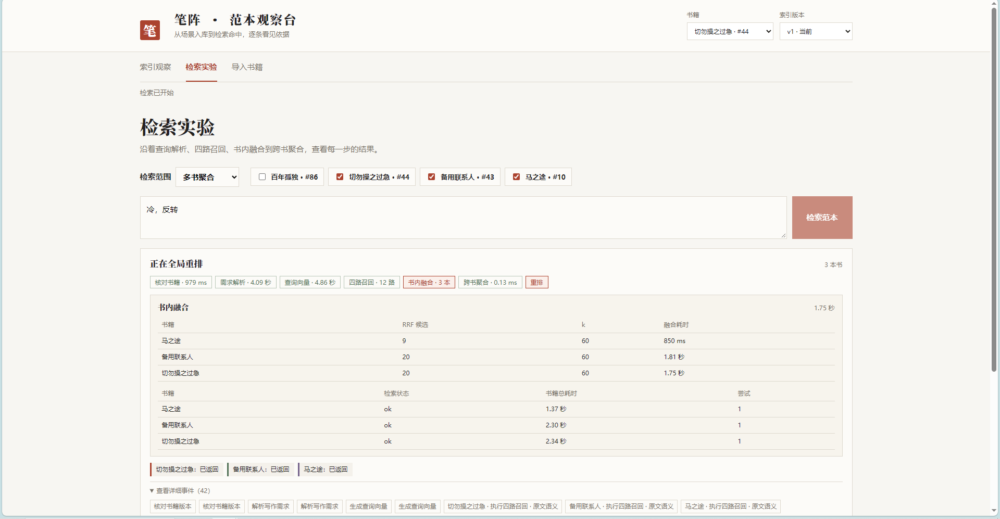
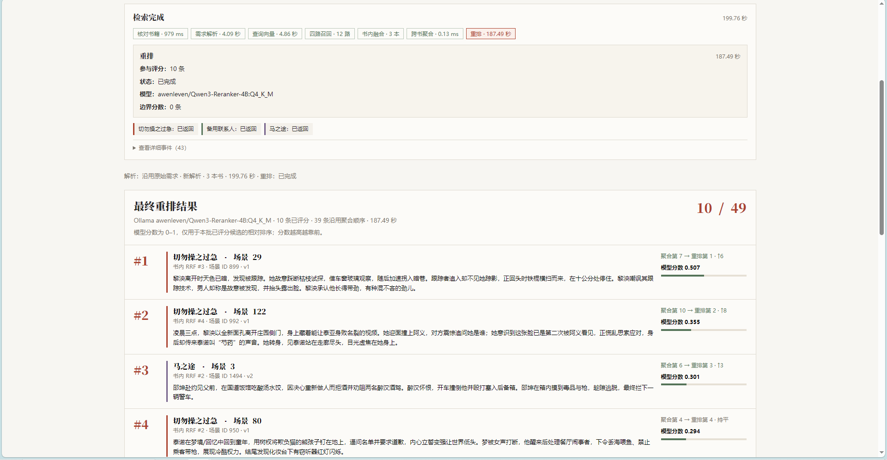
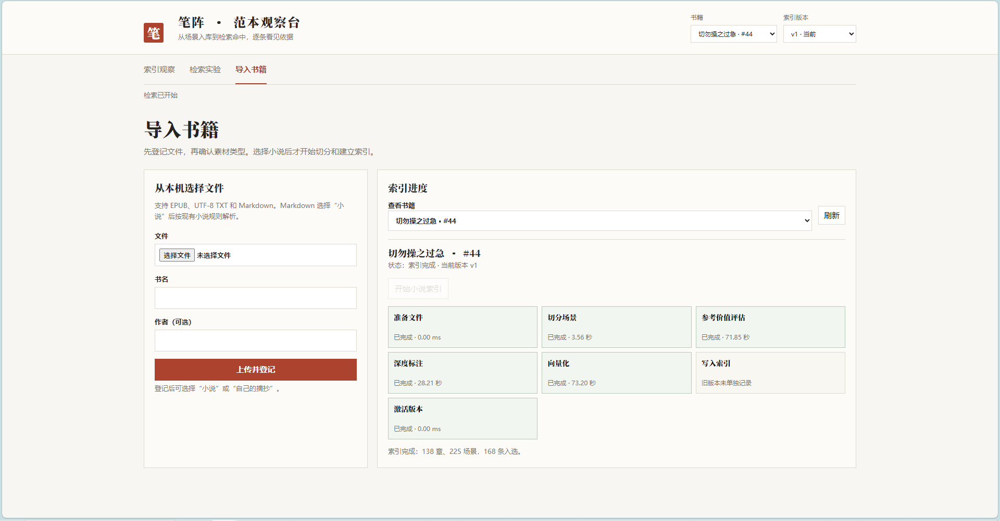
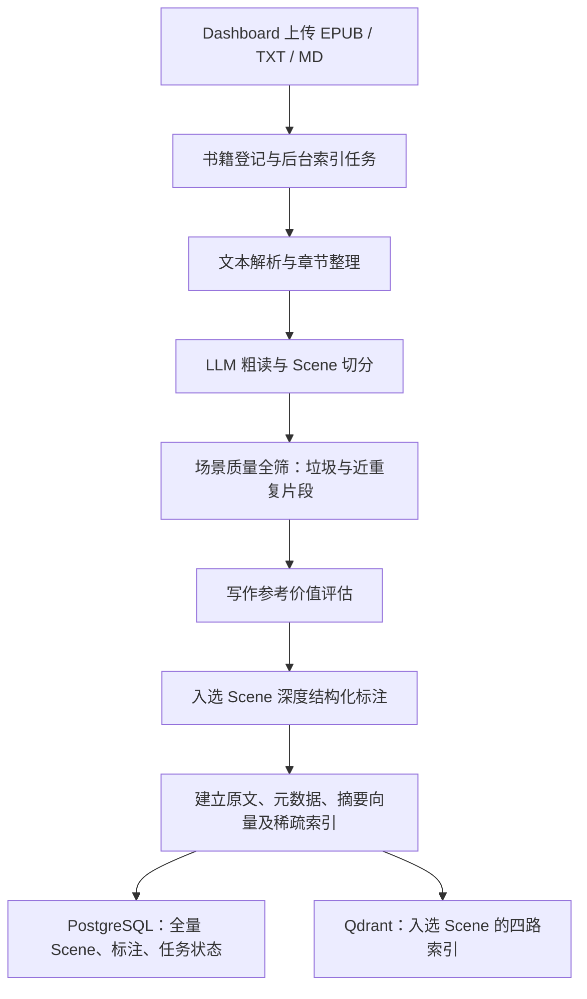
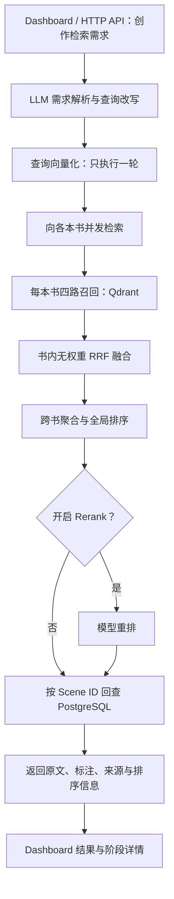
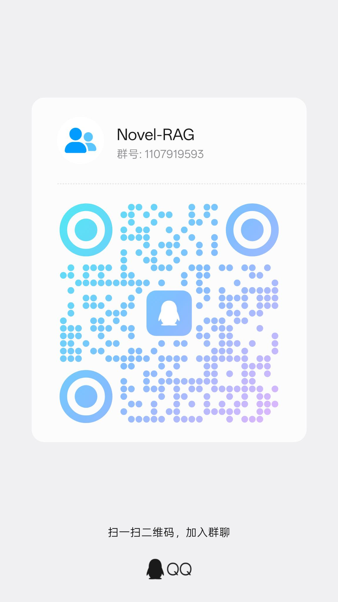

# Novel-RAG

> **让小说从文本，变成可被机器理解、检索和复用的写作经验。**

**Novel-RAG** 是小说创作项目 **novel-creator** 的基础能力之一，也可以独立部署为小说理解与写作范本检索服务。

当前版本：**0.9.0**。最新方案见 [`docs/prd/novel-rag-prd-v0.9.md`](docs/prd/novel-rag-prd-v0.9.md)；v0.8 已归档。

## 愿景

我们希望解决的核心问题是：**如何让 AI 真正读懂一本小说中值得学习的部分。**

长篇小说中的段落承担着不同功能：剧情过渡、信息承接、日常对白和关键冲突场景的写作参考价值并不相同。有效的场景通常还包含可以迁移的节奏控制、人物互动、情绪推进、信息隐藏、叙事结构与语言风格。

**Novel-RAG** 将作品转化为可检索的写作经验：

```text
小说 → 章节 → Scene → 场景质量全筛 → 写作参考价值判断 → 深度理解与结构化标注
     → 语义索引 → 按创作需求检索
```

系统保留完整的 Scene 资产，并筛选值得参考的场景。当创作系统提出“需要人物关系紧张、对白带有试探感、逐步暴露信息的场景”时，它应能找到**适合这个任务的 Scene，并说明参考价值**。

项目的目标是在原始小说与 AI 创作系统之间建立 **Writing Reference Layer（写作范本层）**。它不直接生成小说正文；除了 `novel-creator`，其他 Agent、研究工具或个人知识库也能使用它。服务以**云服务（HTTP）**或 **stdio MCP** 两种形态交付，对外既可返回**待拼接的结构化素材**，也可返回**拼接完成的提示词**。**多书聚合是最高层抽象接口**；单书检索作为聚合器的内部构件保留。长期方向是一套通用的 **Novel Understanding & Writing Reference Engine**：让机器理解 **这一段为什么有效，以及什么时候值得这样写。**

## 当前能力

| 环节 | 已实现内容 |
| --- | --- |
| 导入 | Dashboard 可点击或拖拽上传 EPUB、UTF-8 TXT、UTF-8 MD；首次登记后选择“小说”启动索引。重复上传先确认取消或生成下一版本，旧版 Scene 保留。个人摘抄入口尚未实现。 |
| 拆解 | EPUB 按阅读顺序提取正文并保留章节边界；LLM 粗读有界段落窗口后切分 Scene，保留全部原文。 |
| 判断与标注 | 场景切分完成后，先用全书重复证据与 LLM 筛除垃圾、近重复片段，再评估写作参考价值；仅对入选 Scene 做深度结构化标注。 |
| 索引 | PostgreSQL 保存全部场景与标注；Qdrant 为入选场景保存三路稠密向量及一路稀疏向量。 |
| 检索 | 自然语言需求解析、四路召回、书内无权重 RRF、多书并发聚合（最高层接口）、可选 Ollama 重排。 |
| 交付 | 云服务 HTTP + stdio MCP；`fragments`（待拼接素材）与 `prompt`（拼接完成提示词）两种输出契约。 |
| 观察 | Dashboard 展示导入与检索阶段、耗时、错误、解析 JSON、候选排序和完整 Scene 回查。 |

`archived` 表示有效场景未入选写作范本；`discarded` 表示质量全筛剔除的垃圾或近重复片段。两者的原文都保存在 PostgreSQL，均不进入 Qdrant。多书检索只做一次查询解析与向量化，再并发检索各书；全局重排失败时保留聚合结果。个人素材库与写作质量标注仍在规划中；上下文拼接契约已在 v0.9 PRD 中确定，代码实现排入后续里程碑。

## 交付形态

- **本机 + Cloudflare Tunnel（当前）**：HTTP 接口已可用，包括多书聚合 `POST /api/v1/search/multi`；隧道前必须补访问控制。
- **云服务器 / 托管云（以后可能的实现）**：领域契约与网络形态解耦，迁移时预计只需补持久化部署与网关鉴权。
- **stdio MCP（已实现第一版）**：调用方只需给出写作目标，服务端完成查询规划、检索与提示词拼装；工具与说明见下节。
- **两种输出**：`fragments` 返回结构化素材与引用信息，由调用方拼接；`prompt` 由服务端按预算和模板拼接完成，是当前实现目标。两者都返回可追溯的引用表与预算报告。

## MCP 服务

```bash
uv run python -m app.mcp_server
# 或安装入口后
uv run novel-rag-mcp
```

调用方（写作 Agent）通常只知道“想写什么样的段落”，不知道如何拼检索查询。MCP 的主工具
`search_writing_references` 接收写作目标、细纲上下文与约束，内部完成查询规划、多书检索、
去重/截断/预算拼装，返回可直接使用的 `prompt.text` 或结构化 `fragments`。

| 工具 | 作用 |
| --- | --- |
| `search_writing_references` | 主入口：写作目标 + 细纲/约束 → 提示词或 fragments |
| `plan_writing_query` | 只预览生成的检索查询，不执行检索 |
| `build_reference_prompt` | 进阶：直接给检索 query，返回拼装结果 |
| `get_scene` | 按 `book_id` / `version` / `scene_id` 回查原文与标注 |
| `list_books` | 列出书籍与当前版本 |
| `get_usage_guide` | 返回“如何向本服务提问”的完整说明 |

同一份说明以三种形式提供：MCP 工具 `get_usage_guide`、MCP 资源 `novel-rag://usage-guide`，
以及可安装的 skill：[`skills/novel-rag-writing/SKILL.md`](skills/novel-rag-writing/SKILL.md)。
MCP 默认不重排（`use_rerank=false`）；`prompt` 的字符预算默认 6000，可通过 `budget_chars` 调整。

## 界面预览

### 场景与标注观察

以本地索引的《百年孤独》首页为例，查看 Scene 的切分信息、参考价值评估、标注和全书标签分布。



这次本地索引生成 **20 章、113 个 Scene**；其中 **109 个入选参考、4 个归档、0 个评估失败**，PostgreSQL 与 Qdrant 的入选索引数量均为 **109**。这些是本地版本 v3 的观察结果，用于展示切分与索引效果；《百年孤独》的原文、标注和向量**已包含**在下方四本书测试库中。

### 多书检索实验

查看需求解析、四路召回、书内融合、跨书聚合与重排的阶段详情和耗时。



### 重排结果

展示重排前后的名次变化、模型分数与场景来源。



### 书籍导入与索引进度

上传书籍后查看切分、评估、标注、向量化和索引激活的执行状态。



## 技术栈与整体框架

- Python 3.11、FastAPI、Pydantic Settings、SQLAlchemy Core、psycopg
- PostgreSQL：书籍、章节、全量 Scene、标注、索引任务及查询缓存
- Qdrant：入选 Scene 的 `text-dense`、`meta-dense`、`summary-dense`、`text-sparse` 索引
- Ollama：`bge-m3` Embedding；可选 Qwen3 Reranker
- LLM：OpenAI 兼容 API 或 `codex_exec` 适配器，用于场景切分、质量全筛、参考价值判断、深度标注和需求解析
- 单页 Dashboard：导入、阶段观察、检索实验及结果详情

### 拆书与索引



Dashboard 可查看索引任务的阶段、耗时与详情。质量全筛剔除的 `discarded` Scene 和参考价值评估未入选的 `archived` Scene 保留在 PostgreSQL，不进入 Qdrant。

### 多书聚合检索



Rerank 仅在检索时按配置执行；未开启时直接返回聚合排序结果。

## 部署条件

- Docker Compose；若本机运行，需 Python 3.11 与 [`uv`](https://docs.astral.sh/uv/)。
- PostgreSQL、Qdrant、Ollama。Compose 会启动这三个服务并持久化数据。
- 可调用的 LLM：在 `.env` 配置 `LLM_BASE_URL`、`LLM_API_KEY`、`LLM_MODEL`，或配置 `codex_exec` 适配器。
- 首次启动会下载 Embedding 模型；开启重排时还会下载 Reranker。模型下载和推理需要足够的磁盘、内存与算力，CPU 可运行但会较慢。
- 当前 API 没有用户认证。Compose 默认只将服务端口绑定到 `127.0.0.1`；对公网开放前须自行加访问控制。
- 公网访问当前采用**本机 + Cloudflare Tunnel（或同类内网穿透）**，不租赁服务器；云服务器/托管云服务是以后可能的实现。隧道只转发应用 HTTP，启用前必须配置 Cloudflare Access、API Key 或反向代理鉴权，且不要暴露 PostgreSQL/Qdrant/Ollama 端口。
- 本机默认数据库为观察库 `novel-rag-test-2`（含多书观察数据）；生产部署请使用独立数据库并在迁移后导入或重新索引书籍。
- stdio MCP 交付形态是 v0.9 的实现重点，但工具集合与调用粒度尚未定型；当前对外入口为 HTTP API。

### Docker Compose 启动

```bash
cp .env.example .env
# 编辑 .env：至少设置 POSTGRES_PASSWORD 和 LLM 相关配置
docker compose up -d --build
```

打开 `http://127.0.0.1:8000/dashboard`；交互式 API 文档在 `http://127.0.0.1:8000/docs`。Compose 中应用连接容器内 PostgreSQL、Qdrant、Ollama，宿主机的 `.env` 不需要改成容器服务名。默认仅下载 `bge-m3`；将 `.env` 中 `RERANK_ENABLED=true` 后，执行 `docker compose run --rm ollama-init` 拉取 Reranker。重排开关在每次多书检索前从 `.env` 读取；其他配置更改后应重启 `app`。

Compose 使用持久化卷保存 PostgreSQL、Qdrant 和 Ollama 模型；上传书籍与转换文本在 `data/books/`、`data/converted/`。这些运行数据被 Git 忽略。首次迁移由 `migrate` 服务完成，重复运行迁移脚本不会清空数据。

### 本机开发

```bash
uv sync
cp .env.example .env
# 配置 .env，并准备 PostgreSQL、Qdrant、Ollama
uv run python -m app.db.migrate migrations/001_init.sql
uv run python -m app.db.migrate migrations/002_tag_vocab_aliases.sql
uv run python -m app.db.migrate migrations/003_reference_evaluation.sql
uv run python -m app.db.migrate migrations/004_query_parsing_cache.sql
uv run python -m app.db.migrate migrations/005_scene_split_cache.sql
uv run python -m app.db.migrate migrations/006_scene_quality_screen.sql
uv run python -m app.db.migrate migrations/007_index_job_queue.sql
uv run uvicorn app.main:app --host 127.0.0.1 --port 8000
```

`POSTGRES_DB` 指向需要初始化的数据库；本机默认使用观察库 `novel-rag-test-2`，其中包含多书观察数据与本地索引的《百年孤独》。`POSTGRES_TEST_DB` 默认与该库一致；生产或 CI 建议另建独立库。Windows PowerShell 中将 `cp` 换成 `Copy-Item` 即可。真实密钥只放在本机 `.env`，不要提交。

场景边界判断会按模型、提示词版本与输入内容缓存到 PostgreSQL；长篇索引中断后可复用已完成窗口。`SCENE_MIN_CHARS` 控制接受模型边界的最小场景长度。升级旧版本后，已有书籍需重新索引才能采用新的 EPUB 章节与场景切分结果。

质量全筛在全部场景切分后运行，逐场景调用 LLM，并提供全书重复段落比例和最相近场景节选；极端重复的片段还会被明确规则兜底拦截。剔除的原文仍留在 PostgreSQL，以 `discarded` 独立计数，原因可在 Dashboard 中查看，不进入标注和 Qdrant；旧版本不会自动补筛，需重新索引。

### 索引任务队列（无中间件）

迁移 `007_index_job_queue.sql` 后，索引请求进入 PostgreSQL 队列，由进程内 worker 领取执行：租约、心跳、重试退避与阶段 checkpoint 全部在库里，不需要 Redis/Celery。开启方式：

```bash
# .env
INDEX_WORKER_ENABLED=true
```

配置项包括 `INDEX_WORKER_POLL_SECONDS`、`INDEX_WORKER_HEARTBEAT_SECONDS`、`INDEX_WORKER_LEASE_SECONDS`、`INDEX_JOB_MAX_ATTEMPTS`、`INDEX_JOB_RETRY_BACKOFF_SECONDS`。worker 崩溃或 API 重启后，过期租约会被下一次启动回收，并从 `checkpoint.completed_stages` 之后继续；`split` 已完成时不会重新切分覆盖下游结果。未开启 worker 时，`POST /books/{book_id}/index` 保持旧的同步后台任务行为（测试与轻量调试用）。

重复上传按文件 SHA-256 或相同书名与作者识别；未确认时返回现有书籍与下一版本号，不改动登记记录。确认后替换该书用于下一轮索引的源文件并启动索引；旧版 Scene 与向量仍按版本保留。版本号由当前版本递增，因此已有 v2 的书下一轮会生成 v3。

## 四本书测试库

`sql/fixtures/public-books/` 是可恢复的多书检索样本，保存四本已获授权的公开测试作品在 2026 年 11 月 13 日导出的当前索引版本。本地后续重新索引不会自动写回这份快照：

| 书名 | book_id | version | Scene | Qdrant 入选点 |
| --- | ---: | ---: | ---: | ---: |
| 马之途 | 10 | 3 | 9 | 8 |
| 备用联系人 | 43 | 2 | 88 | 54 |
| 切勿操之过急 | 44 | 2 | 129 | 89 |
| 百年孤独 | 86 | 3 | 113 | 109 |

`postgres.sql` 包含书籍登记、章节全文、Scene 原文与标注、标签词表和稀疏词映射；`qdrant/*.jsonl` 包含对应向量和场景元数据。`manifest.json` 记录版本、行数、点数及 SHA-256。**原始 EPUB/TXT 未包含在快照中**；恢复后可以检索、浏览，若要重新索引请通过 Dashboard 重新上传原文件。

快照不包含 API 密钥、查询历史、模型输入缓存、Embedding 缓存或索引任务日志。本机 `source_path` 已替换为占位路径。不要把个人数据库直接 `pg_dump` 后提交到公开仓库。作品数据的权利说明与 takedown 流程见 [`sql/fixtures/public-books/NOTICE.md`](sql/fixtures/public-books/NOTICE.md)。

### 检索质量基线

- 多书规模化基线（含《百年孤独》，4 本书、28 条单书探针 + 4 条多书聚合探针）：[`reports/retrieval-baseline-multi-book-2026-11-13.md`](reports/retrieval-baseline-multi-book-2026-11-13.md)。单书 RRF Hit@5 为 28/28；剧情摘要 28/28、原文语义 27/28、风格与技法 25/28；多书聚合 4/4 查询成功并覆盖全部书单书籍，平均约 4.2 s；解析降级 0。
- 风格与技法路由诊断（查询构造 + 向量空间塌缩证据）：[`reports/meta-route-diagnosis-2026-11-13.md`](reports/meta-route-diagnosis-2026-11-13.md)。查询锚点修复把命中从 9/28 提到 24/28。
- meta 向量重建（260 个场景、0 失败，书内余弦 0.81→0.69）：[`reports/meta-vector-rebuild-2026-11-16.md`](reports/meta-vector-rebuild-2026-11-16.md)。重建后该路由 25/28，RRF 28/28。
- 早期单书基线（《马之途》10 条探针）：[`reports/archive/retrieval-baseline-ma-zhitu-2026-09-29.md`](reports/archive/retrieval-baseline-ma-zhitu-2026-09-29.md)。

可选重排在 5 条候选上耗时约 144 s，且重排本身是高耗时任务，暂不进入实时写作链路；优化方向（分数缓存、后台预计算、超时回退）见 PRD §13.3。

复现：

```bash
uv run python -B -m tests.real.run_retrieval_baseline
```

meta 向量重建（风格签名 → 只重嵌入 `meta-dense`，幂等）：

```bash
uv run python -B -m scripts.rebuild_meta_vectors --book-ids 10 43 44 86 --workers 10
```

在全新 Compose 数据卷中启动并完成迁移后导入：

```bash
docker compose exec app python -m scripts.restore_public_postgres sql/fixtures/public-books
docker compose exec app python -m scripts.restore_public_qdrant sql/fixtures/public-books
```

导入脚本要求目标 Qdrant 中不存在同名 Collection；SQL 也应仅导入到空的项目库。成功后访问 Dashboard，或提交多书检索：

```json
{"query":"寻找人物关系紧张、对话带有试探意味的场景","book_ids":[10,43,44,86],"per_book_limit":20,"global_limit":50}
```

源快照可由已授权的数据库重新生成：

```bash
uv run python -m scripts.export_public_fixture --book-ids 10 43 44 86 --database novel-rag-test-2 --output sql/fixtures/new-export --confirm-public-rights
```

### 作品与侵权联系

测试库中的四本作品及其衍生标注仅用于展示小说理解与检索功能，不因代码仓库公开而授予第三方复制、改编或再分发作品的权利。**若权利人认为相关内容侵权，请通过本仓库 Issues 联系维护者；收到通知后会立即处理、删除相关公开测试数据，并处理仓库历史中的相应内容。**

项目代码采用 [MIT 许可证](LICENSE)，作品原文及测试库内容不适用该许可证。仓库主页：[a-big-fish/Novel-RAG](https://github.com/a-big-fish/Novel-RAG)。

## API 文档

运行后访问 `/docs` 查看 OpenAPI 交互文档，`/openapi.json` 获取机器可读规范。健康检查为 `GET /health`，业务接口统一以 `/api/v1` 开头。

| 用途 | 主要接口 |
| --- | --- |
| 书籍登记与索引 | `POST /books/upload`、`GET /books`、`POST /books/{book_id}/index`、`GET /books/{book_id}/jobs` |
| 版本与场景 | `GET /books/{book_id}/versions`、`GET /books/{book_id}/versions/{version}/scenes`、`GET /scenes/{scene_id}` |
| 单书检索（内部构件） | `POST /books/{book_id}/search`、`POST /books/{book_id}/search/stream` |
| **多书聚合（主接口）** | `POST /search/multi`、`POST /search/multi/stream` |
| 写作参考组装 | `POST /assemble` |
| 组件调试 | `POST /qdrant/collections/{collection}/points/search`、`GET /qdrant/collections/{collection}/points/{point_id}` |

两个 `/stream` 接口返回 NDJSON：`progress` 表示阶段进度，`result.data` 是最终结果，`error.message` 表示失败。完整的 Scene 原文通过数据库详情接口回查；RRF 候选仅携带 `scene_id` 与限长预览。

全局重排由 `.env` 中的 `RERANK_ENABLED` 控制。启用后使用 `OLLAMA_RERANK_MODEL` 对跨书候选评分；失败时 `rerank.status` 和诊断日志会给出原因，最终候选退回聚合顺序。重排可能明显增加检索时间。

## 测试

```bash
uv run pytest tests/unit -q
uv run pytest tests/integration -q -m integration
```

单元测试不依赖外部服务；集成测试需要 PostgreSQL、Qdrant 和测试隔离环境。模型测试仅发送 Scene 或有界样本，不会把整本书作为单次模型输入。测试库快照的数据恢复还会检查 SQL 行数与 Qdrant Point 数量。

## 目录结构

```text
app/                    FastAPI、LLM/Ollama 客户端、索引与检索服务
app/mcp_server.py       stdio MCP 服务（写作参考主入口）
app/prompts/            切分、质量全筛、判断、深度标注、需求解析、重排与组装提示词
skills/                 可安装的 Agent skill（含 Novel-RAG 组装 skill）
dashboard/              导入、索引进度和检索实验界面
docs/prd/               当前 PRD v0.9 与归档的历史版本
images/                 README 展示用的界面截图
migrations/             PostgreSQL 迁移历史
reports/                检索质量基线报告与归档
sql/fixtures/public-books/
                        四本书的 PostgreSQL 数据 SQL、Qdrant JSONL、校验清单与权利说明
scripts/                测试库导出与 Qdrant 恢复脚本
tests/                  单元、集成、手工真实链路与基线脚本
data/                   本地上传与转换缓存，不进入 Git
compose.yaml            PostgreSQL、Qdrant、Ollama 与应用编排
Dockerfile              应用镜像
```

## 交流社区

Novel-RAG QQ 群：**1107919593**。可搜索群号或扫描下方二维码加入。


